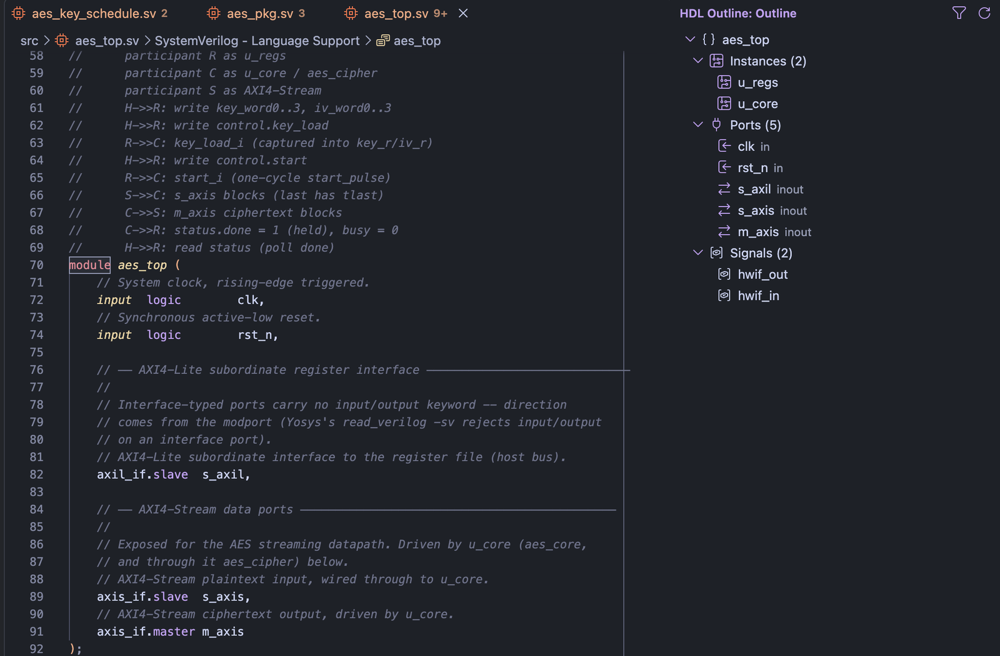
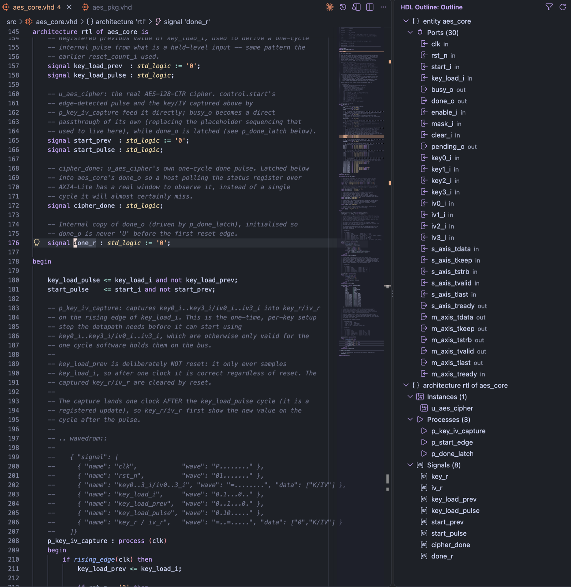

# HDL-Outliner

HDL-Outliner adds a side-panel view that breaks the active SystemVerilog, Verilog or VHDL file into collapsible groups: **Instances, Processes, Ports, Constants, Types, Signals and Functions**, per module / entity / package / interface. Click any entry to jump to it. It reads symbols from the language server you already use (verible-ls, vhdl_ls) and fills in what those servers leave out with a small text scan.



*SystemVerilog (verible-ls): `aes_top.sv` from the AES project. Interface-typed ports such as `axil_if.slave s_axil` show as `inout`.*



*VHDL (vhdl_ls): `aes_core.vhd` from the AES project. Ports show their direction; the architecture lists its instances, processes and signals.*

**Version 0.1.0** (first release). See the [changelog](CHANGELOG.md).

## Install

This release is distributed as a VSIX:

```
code --install-extension hdl-outliner-0.1.0.vsix
```

Then open the **HDL Outline** icon in the activity bar and click an SV, Verilog or VHDL file.

## Features

- Shows the **active editor's file only** and follows you as you switch tabs. The outline refreshes shortly after you stop typing. While the file has a syntax error and the language server returns nothing, the last good outline stays on screen.
- Ports show their direction: `in`, `out` or `inout`. Interface-typed ports (`axil_if.slave s_axil`) show as `inout`.
- The filter button in the panel title hides groups you don't want, for example Signals. The choice is remembered per workspace.
- The refresh button re-reads the file, useful if the language server wasn't ready when the file was opened.
- If no language server answers for a file, the panel says so instead of showing a partial outline silently.
- `HDL Outline: Dump Symbols (debug)` (command palette) opens what the language servers returned next to what the outline built from it. Attach it to bug reports.

## Requirements

You need a language server running for each language you want a full outline for:

- **SystemVerilog / Verilog:** e.g. the `chipsalliance.verible` extension (verible-verilog-ls).
- **VHDL:** e.g. the `hbohlin.vhdl-ls` extension.
  - On Apple Silicon that extension has no embedded server, so set `vhdlls.languageServer` to `systemPath` and install `vhdl_ls` (`cargo install vhdl_ls`). `vhdl_ls` also needs its `vhdl_libraries` folder next to the install (`~/.cargo/vhdl_libraries`), or it exits on start-up.
  - Add a `vhdl_ls.toml` to the project so the server knows which files belong to which library.

If you have more than one extension providing symbols for a language (for example Verible and `eirikpre.systemverilog`), units with the same name are merged rather than shown twice.

## Known limits

- **verible-ls omissions:** it does not report parameters, typedefs, tasks, ports, plain `wire` declarations, unlabeled `always` / `initial` blocks, `assign`, modports or assertions. Constants, types, tasks and ports are recovered with a regex scan of the source; the rest are not shown.
- **Port scan:** only the first name after a direction keyword is found (`input logic a, b` misses `b`), and an interface port with no modport (`axil_if s`) is missed. Interface ports show as `inout` without reading the modport.
- **Regex scan:** constants and types are not parsed, so `parameter A = 1, B = 2` loses `B`.
- **VHDL:** component declarations are listed under Types and aliases under Signals.
